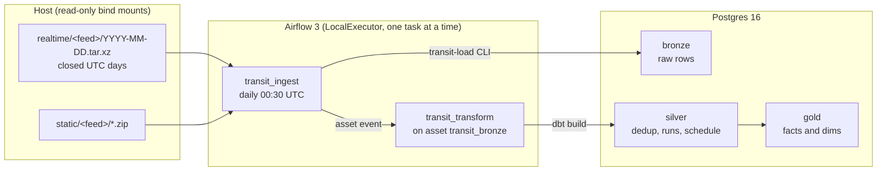

<p align="center"></p>

# transit-pipeline

transit-pipeline is a batch data pipeline for Klang Valley public transport. It reads GTFS static zips and
GTFS-Realtime vehicle position snapshots from a local archive. It loads them into Postgres in three layers
(bronze, silver, gold). Airflow runs the loads. dbt builds the silver and gold tables and tests them.

The gold tables answer these questions for each route and service day:

- How many runs did the realtime feed observe, and how many did the timetable schedule?
- How regular was the gap between buses (headway) where the feed tracks enough of the fleet?
- How many buses ran in each hour?
- When did the feed stop sending data?

## Architecture



- `loader/` is a Python package with the `transit-load` CLI. It loads one closed archive day, or every new static version.
- `dags/transit_ingest.py` loads static versions, then the archive day that closed before the run.
- `dags/transit_transform.py` runs `dbt build`, then `dbt source freshness`.
- `dbt/` holds the silver and gold models, the tests, and the docs.

## Run it

You need Docker with Compose, `make`, and `uv` (for the loader tests).

1. Copy `.env.example` to `.env`.
2. Set `TRANSIT_DATA` to the folder that holds the `realtime/` and `static/` folders.
3. Set `AIRFLOW_UID` to your user id (`id -u`). Set a new `POSTGRES_PASSWORD` and `AIRFLOW_JWT_SECRET`.
4. Start the stack:

   ```sh
   make up
   ```

5. Load the last 7 closed archive days:

   ```sh
   make backfill FROM=2026-11-18 TO=2026-11-24
   ```

   Each ingest run sends an asset event. The event starts `transit_transform`, which rebuilds the changed service dates.

6. Open the Airflow UI at http://127.0.0.1:8280.
7. Query the gold tables:

   ```sh
   make psql
   ```

   ```sql
   select service_date, route_id, observed_trips, scheduled_trips, coverage, pct_on_headway, feed_uptime_pct
   from gold.fct_route_day
   where feed = 'prasarana-rapid-bus-kl' and service_date = '2026-11-20'
   order by observed_trips desc;
   ```

After `make up`, the daily load needs no action. `transit_ingest` runs at 00:30 UTC. The source closes each UTC
day at about 00:08 UTC. If the archive is not there yet, the task fails and Airflow tries again 3 times, 20 minutes apart.

### Other commands

| Command | What it does |
|---|---|
| `make test` | Runs the loader tests and the dbt unit tests. The stack must be up, and dbt must have built once. |
| `make dbt-build` | Runs `dbt build`. Add `FROM=YYYY-MM-DD TO=YYYY-MM-DD` to rebuild that range of service dates. |
| `make docs` | Writes the dbt docs to `dbt/target/static_index.html`. |
| `make logs` | Shows the container logs. |
| `make stats` | Shows the memory use of each container. |
| `make down` | Stops the stack. The Postgres volume stays. |

To load one day by hand, run the same command that the DAG runs:

```sh
docker compose exec airflow-scheduler transit-load realtime --date 2026-11-24
docker compose exec airflow-scheduler transit-load static
```

To rebuild silver and gold for a date range without a reload, trigger `transit_transform` with
`{"start_date": "2026-11-19", "end_date": "2026-11-24"}`.

You can run every command more than one time. A reload replaces that archive day in one transaction. A static
version that is already loaded is not loaded again. A dbt run deletes and rebuilds the service dates in its window.

## Data source and its limits

The pipeline reads files only. It never calls an API.

- The source is the local archive of the `gtfs-hoarder` service. Harith owns that service and its archive.
  The pipeline mounts only `realtime/` and `static/`, read-only. It does not change, restart, or read any other part of it.
- Do not poll `api.data.gov.my` from this host. The hoarder already uses the rate limit of the API.
- The hoarder writes each UTC day to an open `.tar` file. At about 00:08 UTC it closes the day as `.tar.xz`.
  The loader reads only closed `.tar.xz` days.
- The data has no driver or staff data. Do not add any.

Feeds:

| Feed | Realtime | Static | Use in gold |
|---|---|---|---|
| `prasarana-rapid-bus-kl` | yes | frequencies | runs, headway, coverage, activity, gaps |
| `prasarana-rapid-bus-mrtfeeder` | yes | timetable | runs, headway, coverage, activity, gaps |
| `ktmb` | yes, not usable | timetable | feed gaps and schedule only |
| `prasarana-rapid-rail-kl` | no | frequencies | schedule and routes only |

### Metric caveats

- **Coverage is not operator performance.** `coverage` = observed runs / scheduled departures. The rapid-bus-kl
  feed tracks only part of the fleet: average route coverage is about 0.24 for kl and 0.83 for mrtfeeder (2026-11-19 to
  2026-11-24). Read `coverage` as a lower bound on delivered service. Some routes are above 1.
- **Headway needs coverage.** The model classifies a headway only on route patterns with coverage of 0.9 or more.
  Other runs get `low_coverage`. So `pct_on_headway` is often NULL on kl.
- **A run starts at its first valid ping.** The feeds do not give a dispatch time. On kl, the RT `start_time` is set
  when the feed first sees a run, so it is not a timetable time.
- **ktmb realtime is not usable.** It sends a fixed set of placeholder positions, and its `vehicle.id` is the `trip_id`.
  The loader keeps it in bronze. Gold uses it only in `fct_feed_gap`.
- **Service day.** A service date runs from 03:00 to 03:00 Malaysia time (MYT). It needs the UTC archives of the
  day before and of the same day. So 7 archive days give 6 complete service dates, and a date appears about 8 hours after it ends.
- **Feed uptime.** `feed_uptime_pct` covers the scheduled service span only. At night the feeds send empty
  snapshots, and the pipeline counts an empty snapshot as a gap.

## Design choices

- **Batch, not a stream.** The source is a closed file per feed per day. A stream (Kafka or Redpanda) would add
  a broker and RAM, but no new data. A stream becomes useful only if the pipeline reads the live API, or if a
  consumer needs results within minutes. Both are out of scope, and the first one is not allowed from this host.
- **Two units of time.** Bronze uses the archive day (the unit that arrives). Silver and gold use the service date
  (the unit that riders use). The model `int_complete_dates` is the only bridge. It lists complete dates only, so no
  gold row is partial.
- **The window comes from bronze state.** The asset event only starts the transform. dbt then rebuilds each
  complete date that was never built, or that has a newer load than its last successful build (`silver.build_log`).
  A failed run writes no build stamps, so the next run tries those dates again.
- **Static bronze stores each file content one time.** The loader keys GTFS rows on the sha256 of the file. The
  mrtfeeder has 52 versions but only 5 different `stop_times.txt` files.
- **One run model and one schedule model for all feeds.** Sessionization (gaps and islands over each vehicle's
  pings) gives runs for every feed. Frequency windows and timetable trips go into one departures table.
- **Thin DAGs.** The DAGs call the `transit-load` CLI and `dbt` through `@task.bash`. The loader runs and tests without Airflow.

See [docs/design.md](docs/design.md) for the full design and the changes made during the build.

## Memory

The host has about 4.8 GB free. The stack has hard limits that add up to 1.6 GB: Postgres 320 MB,
API server 336 MB, scheduler 704 MB, DAG processor 240 MB. The one-time `airflow-init` container has 512 MB and exits before the others start.

Measured with `docker stats` (2 s samples) on 2026-11-25:

| Phase | Postgres | API server | Scheduler | DAG processor | Total at peak |
|---|---|---|---|---|---|
| Backfill load (3 feeds a day) | 300 MiB | 279 MiB | 482 MiB | 154 MiB | 1.15 GiB |
| Full dbt build in Airflow (6 service dates) | 305 MiB | 276 MiB | 599 MiB | 162 MiB | 1.27 GiB |
| Full dbt build again, final limits | 305 MiB | 278 MiB | 589 MiB | 225 MiB | 1.30 GiB |

## Credit and licence

The data comes from the GTFS static and GTFS-Realtime feeds of Prasarana and KTMB, which the Malaysian
government publishes on the data.gov.my open data portal under the
[Creative Commons Attribution 4.0 (CC BY 4.0)](https://creativecommons.org/licenses/by/4.0/) licence.

- Portal: https://data.gov.my
- API reference: https://developer.data.gov.my/realtime-api/gtfs-realtime
