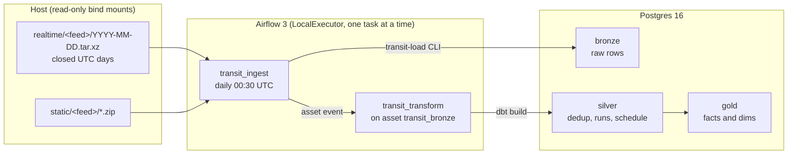

<p align="center"></p>

# transit-pipeline

transit-pipeline is a batch data pipeline for Klang Valley public transport. It reads GTFS static zips and
GTFS-Realtime vehicle position snapshots from a local archive. It loads them into Postgres in three layers
(bronze, silver, gold). Airflow runs the loads. dbt builds the silver and gold tables and tests them.

The gold tables answer these questions for each route and service day:

- How many runs did the realtime feed observe, and how many did the timetable schedule?
- How regular was the gap between buses (headway) where the feed tracks enough of the fleet?
- How many buses ran in each hour?
- When did the feed stop sending data?

## Architecture



- `loader/` is a Python package with the `transit-load` CLI. It loads closed archive days and new static versions.
- `dags/transit_ingest.py` loads new static versions, then every closed archive day that is not loaded yet.
- `dags/transit_transform.py` runs `dbt build`, then `dbt source freshness`.
- `dbt/` holds the silver and gold models, the tests, and the docs.

## Run it

You need Docker with Compose, `make`, and `uv` (for the loader tests).

1. Copy `.env.example` to `.env`.
2. Set `TRANSIT_DATA` to the folder that holds the `realtime/` and `static/` folders.
3. Set `AIRFLOW_UID` to your user id (`id -u`). Set a new `POSTGRES_PASSWORD` and `AIRFLOW_JWT_SECRET`.
   Use only letters, digits and `-._~` in the password, because it goes into connection URLs.
   Set `TRANSIT_EARLIEST_DATE` to the first archive day that the daily load must load.
4. Start the stack:

   ```sh
   make up
   ```

5. Load the last 7 closed archive days:

   ```sh
   make backfill FROM=2026-11-18 TO=2026-11-24
   ```

   Each ingest run sends an asset event. The event starts `transit_transform`, which rebuilds the changed service dates.

6. Open the Airflow UI at http://127.0.0.1:8280.
7. Query the gold tables:

   ```sh
   make psql
   ```

   ```sql
   select service_date, route_id, observed_trips, scheduled_trips, coverage, pct_on_headway, feed_uptime_pct
   from gold.fct_route_day
   where feed = 'prasarana-rapid-bus-kl' and service_date = '2026-11-20'
   order by observed_trips desc;
   ```

After `make up`, the daily load needs no action. `transit_ingest` runs at 00:30 UTC. The source closes each UTC
day at about 00:08 UTC. Each run loads every closed archive day from `TRANSIT_EARLIEST_DATE` that is not loaded yet.
So a day that a failed or missed run did not load is loaded by the next run. The loader never reads the open day of
today. A bad static zip is logged and skipped, and the realtime load runs also when the static load fails.

### Other commands

| Command | What it does |
|---|---|
| `make test` | Runs the loader tests and the dbt unit tests. The stack must be up, and dbt must have built once. |
| `make dbt-build` | Runs `dbt build`. Add `FROM=YYYY-MM-DD TO=YYYY-MM-DD` to rebuild that range of service dates. Set both or neither. |
| `make docs` | Writes the dbt docs to `dbt/target/static_index.html`. |
| `make logs` | Shows the container logs. Airflow task logs are in the `airflow-logs` volume and in the UI. |
| `make stats` | Shows the memory use of each container. |
| `make down` | Stops the stack. The Postgres volume stays. |

To reload one day by hand, or to load the days that are not loaded yet:

```sh
docker compose exec airflow-scheduler transit-load realtime --date 2026-11-24
docker compose exec airflow-scheduler transit-load realtime
docker compose exec airflow-scheduler transit-load static
```

To rebuild silver and gold for a date range without a reload, trigger `transit_transform` with
`{"start_date": "2026-11-19", "end_date": "2026-11-24"}`.

You can run every command more than one time. A reload replaces that archive day in one transaction. A static
version that is already loaded is not loaded again. A dbt run deletes and rebuilds the service dates in its window.

## Gap repair

Tower loses power now and then, and Harith's hoarder (collector A) misses snapshots while it's down. Collector B
runs the same hoarder elsewhere, so it usually has the snapshots A missed. `transit-load repair` copies them into
A's archive.

For each feed it looks at the last 8 closed UTC days. A day gets repaired when A has a gap longer than 10 minutes
and B has snapshots inside that gap. B's snapshots go in only where A has nothing within 60 seconds of them. The
repaired day replaces A's `.tar.xz` in one rename, and the loader then loads that day again because its hash
changed. A day that A doesn't have at all is copied from B whole.

The repair stays away from any day the hoarder may still write: today, a day with an open `.tar` or a temp file,
and a day packed less than 5 minutes ago. It changes a day at most once. Every decision goes into the
`bronze.rt_repair` table, so you can see what it did and why. If B's copy of a day is missing or broken, the day
waits and is tried again on the next run, until it falls out of the 8-day window.

`TRANSIT_REPAIR` in `.env` sets the mode:

- `dry` (the default) decides and logs, and writes nothing.
- `on` writes the repaired days. It keeps A's original file in the `repair-state` volume for 30 days.
- `off` does nothing.

Run it by hand from the scheduler container:

```sh
docker compose exec airflow-scheduler transit-load repair
docker compose exec airflow-scheduler transit-load repair --mode dry --feed ktmb --days 3
```

Two things aren't wired up yet. The scheduler mounts A's archive read-only, so `on` can't write until that mount
changes. And nothing fetches B's days into `B_DIR` yet, so every day with a gap waits. There's no DAG for it either.

## Stats API

The stack also serves a read-only HTTP API on the gold data. The
[transit-dashboard](https://github.com/haziqhilmismail/transit-dashboard) page and Harith's per-route panel read it.

- `stats-api` is PostgREST. It serves each table of the `api` schema as `/<table>`. It has no host port.
- `stats-web` is Caddy. It serves the dashboard page from `DASHBOARD_SITE` and sends `/api/*` to `stats-api`.
  It listens on `127.0.0.1:8302` only. If `DASHBOARD_SITE` has no `index.html`, it serves the one-line page in
  `stats/placeholder/`. If the `DASHBOARD_SITE` folder does not exist, Docker makes it as an empty folder owned by root.
- `stats-tunnel` is cloudflared. It runs the Cloudflare tunnel that sends the public host name to `stats-web`, so
  no port is open to the internet. Its `config.yml` and credentials file sit in `STATS_TUNNEL_DIR`, outside git,
  and `config.yml` must point at `/etc/cloudflared/...` paths and at `http://stats-web:80`.
- dbt builds the `api` tables from gold (`dbt/models/api/`). They are tables, not views. A view on a gold table
  is dropped each time dbt replaces that table, and a failed run would then leave the API empty.

### Set it up

1. Clone the dashboard repo next to this repo, or set `DASHBOARD_SITE` in `.env` to its `site/` folder.
2. Set `API_DB_PASSWORD`, `STATS_SITE_HOSTS` and `STATS_TUNNEL_DIR` in `.env`.
3. Make the database roles. `make up` and `make dbt-build` also do this step. You can run it again.

   ```sh
   make api-roles
   ```

4. Build the API tables, then start the services. They are in the compose profile `stats`. Start them with
   `make up` only, because it checks the values from step 2 and makes the roles first. The other `make`
   targets do not need those values.

   ```sh
   make dbt-build
   make up
   ```

5. Get the first rows:

   ```sh
   curl 'http://127.0.0.1:8302/api/route_day?feed=eq.prasarana-rapid-bus-kl&limit=3'
   ```

Each `dbt build` sends `notify pgrst, 'reload schema'` at the end, so PostgREST sees new tables and columns.

### Tables

Each table keeps a fixed number of days up to `data_through`, the newest service date with realtime data. The
`api_days_long` (90), `api_days_short` (35) and `api_days_summary` (28) vars in `dbt/dbt_project.yml` set the
numbers. No table has `vehicle_id`, `trip_id` or another key of one vehicle or one trip.

| Table | One row per | Days |
|---|---|---|
| `meta` | (one row): `data_from`, `data_through`, `feeds`, `attribution`, `licence_url` | - |
| `route_day` | feed, route, service date: `fct_route_day` with the route names | 90 |
| `route_summary` | feed, route: totals of the last 28 days | 28 |
| `headway_day` | feed, service date, headway class: runs | 90 |
| `headway_hist` | feed, bin of `headway_ratio` (width 0.25; 3 and more in one bin): runs | 28 |
| `route_trips` | feed, route, service date, `trip_no` (order of departure): times, duration, headway | 35 |
| `route_schedule` | feed, route, service date, scheduled departure | 35 |
| `route_hour` | feed, route, service date, MYT hour: active vehicles and runs | 35 |
| `network_hour` | feed, service date, MYT hour: active routes and runs | 35 |
| `feed_day` | feed, service date: number of gaps, gap seconds, longest gap, routes, runs, coverage, `on_headway_runs`, `pct_on_headway`, uptime | 90 |
| `feed_gap` | each feed gap | 90 |

Use the PostgREST filters, for example `?feed=eq.ktmb&service_date=gte.2026-11-20&order=service_date`.

### Limits

| Layer | Rule |
|---|---|
| Postgres | `web_anon` (no login) can only `SELECT` the `api` tables. Its statements stop after 2 s. PostgREST runs each GET in a read-only transaction. `authenticator` has at most 5 connections. |
| PostgREST | At most 2,000 rows for each request, a pool of 3 connections, no OpenAPI document, no aggregates. |
| Caddy | GET and HEAD only (else 405). An unknown `Host` gets 421. At most 8 requests in flight to PostgREST. A request waits at most 2 s for a free slot, then gets 503. PostgREST must start its answer in 5 s. |
| Caddy request headers | The URL alone sets the answer, so a cache can use the URL as its key. Caddy sets `Accept: application/json` and removes `Range`, `Range-Unit`, `Prefer`, `Authorization`, `Accept-Profile` and `Content-Profile`. A client cannot ask for an exact count (`Prefer`), CSV, or a single object. |
| Caddy response headers | 2xx `/api/*` answers have `Cache-Control: public, max-age=600`. Errors, 405 and 421 have `Cache-Control: no-store`. The page has `Cache-Control: no-cache`. `/api/*` answers have `Access-Control-Allow-Origin: https://transit.harithilmi.com`. There is no CORS preflight (OPTIONS gets 405), so another origin can only send a GET without custom headers. |

Memory limits: `stats-api` 64 MB, `stats-web` 48 MB. Measured peak under 750 requests (15 rounds of 50 at the same
time, 2,000 rows each, all 200) on 2026-11-26: `stats-api` 36 MiB, `stats-web` 20 MiB.

## Data source and its limits

The pipeline reads files only. It never calls an API.

- The source is the local archive of the `gtfs-hoarder` service. It is part of Harith's KL Transit project
  ([github.com/harithilmi](https://github.com/harithilmi), [transit.harithilmi.com](https://transit.harithilmi.com)).
  Harith owns that service and its archive.
  The pipeline mounts only `realtime/` and `static/`, read-only. It does not change, restart, or read any other part of it.
- Do not poll `api.data.gov.my` from this host. The hoarder already uses the rate limit of the API.
- The hoarder writes each UTC day to an open `.tar` file. At about 00:08 UTC it closes the day as `.tar.xz`.
  The loader reads only closed `.tar.xz` days.
- The data has no driver or staff data. Do not add any.

Feeds:

| Feed | Realtime | Static | Use in gold |
|---|---|---|---|
| `prasarana-rapid-bus-kl` | yes | frequencies | runs, headway, coverage, activity, gaps |
| `prasarana-rapid-bus-mrtfeeder` | yes | timetable | runs, headway, coverage, activity, gaps |
| `ktmb` | yes, not usable | timetable | feed gaps and schedule only |
| `prasarana-rapid-rail-kl` | no | frequencies | schedule and routes only |

### Metric caveats

- **Coverage is not operator performance.** `coverage` = observed runs / scheduled departures. The rapid-bus-kl
  feed tracks only part of the fleet: average route coverage is about 0.24 for kl and 0.83 for mrtfeeder (2026-11-19 to
  2026-11-24). Read `coverage` as a lower bound on delivered service. Some routes are above 1.
- **Headway needs coverage.** The model classifies a headway only on route patterns with coverage of 0.9 or more.
  Other runs get `low_coverage`. So `pct_on_headway` is often NULL on kl.
- **A run starts at its first valid ping.** The feeds do not give a dispatch time. On kl, the RT `start_time` is set
  when the feed first sees a run, so it is not a timetable time.
- **ktmb realtime is not usable.** It sends a fixed set of placeholder positions, and its `vehicle.id` is the `trip_id`.
  The loader keeps it in bronze. Gold uses it only in `fct_feed_gap`.
- **Service day.** A service date runs from 03:00 to 03:00 Malaysia time (MYT). It needs the UTC archives of the
  day before and of the same day. So 7 archive days give 6 complete service dates, and a date appears about 8 hours after it ends.
- **Feed uptime.** `feed_uptime_pct` covers the scheduled service span only. At night the feeds send empty
  snapshots, and the pipeline counts an empty snapshot as a gap.

## Design choices

- **Airflow is more than this job needs.** The job is one daily load and one `dbt build` on one host. Cron or a
  systemd timer can do it, because the loader loads all missed days and dbt reruns are safe. The cron line is
  `transit-load realtime && dbt build`. That uses almost no RAM, and Airflow uses about 1.3 GB.
  This project uses Airflow and dbt together as a learning exercise. It tries Assets, backfills, retries and
  data-aware scheduling on real data.
- **Batch, not a stream.** The source is a closed file per feed per day. A stream (Kafka or Redpanda) would add
  a broker and RAM, but no new data. A stream becomes useful only if the pipeline reads the live API, or if a
  consumer needs results within minutes. Both are out of scope, and the first one is not allowed from this host.
- **Two units of time.** Bronze uses the archive day (the unit that arrives). Silver and gold use the service date
  (the unit that riders use). The model `int_complete_dates` is the only bridge. It lists complete dates only, so no
  gold row is partial.
- **The window comes from bronze state.** The asset event only starts the transform. dbt then rebuilds each
  complete date that was never built, or that has a newer load than its last successful build (`silver.build_log`).
  A failed run writes no build stamps, so the next run tries those dates again.
- **Static bronze stores each file content one time.** The loader keys GTFS rows on the sha256 of the file. The
  mrtfeeder has 52 versions but only 5 different `stop_times.txt` files.
- **One run model and one schedule model for all feeds.** Sessionization (gaps and islands over each vehicle's
  pings) gives runs for every feed. Frequency windows and timetable trips go into one departures table.
- **Thin DAGs.** The DAGs call the `transit-load` CLI and `dbt` through `@task.bash`. The loader runs and tests without Airflow.

See [docs/design.md](docs/design.md) for the full design and the changes made during the build.

## Memory

The host has about 4.8 GB free. The stack has hard limits that add up to 1.71 GB: Postgres 320 MB,
API server 336 MB, scheduler 704 MB, DAG processor 240 MB, stats API 64 MB, stats web 48 MB. The one-time `airflow-init` container has 512 MB and exits before the others start.

Measured with `docker stats` (2 s samples) on 2026-11-25:

| Phase | Postgres | API server | Scheduler | DAG processor | Total at peak |
|---|---|---|---|---|---|
| Backfill load (3 feeds a day) | 300 MiB | 279 MiB | 482 MiB | 154 MiB | 1.15 GiB |
| Full dbt build in Airflow (6 service dates) | 305 MiB | 276 MiB | 599 MiB | 162 MiB | 1.27 GiB |
| Full dbt build again, final limits | 305 MiB | 278 MiB | 589 MiB | 225 MiB | 1.30 GiB |
| Startup ingest + asset-triggered build, then full dbt build (2026-11-26) | 296 MiB | 279 MiB | 633 MiB | 216 MiB | 1.34 GiB |

## Credit and licence

The data comes from the GTFS static and GTFS-Realtime feeds of Prasarana and KTMB, which the Malaysian
government publishes on the data.gov.my open data portal under the
[Creative Commons Attribution 4.0 (CC BY 4.0)](https://creativecommons.org/licenses/by/4.0/) licence.

- Portal: https://data.gov.my
- API reference: https://developer.data.gov.my/realtime-api/gtfs-realtime
